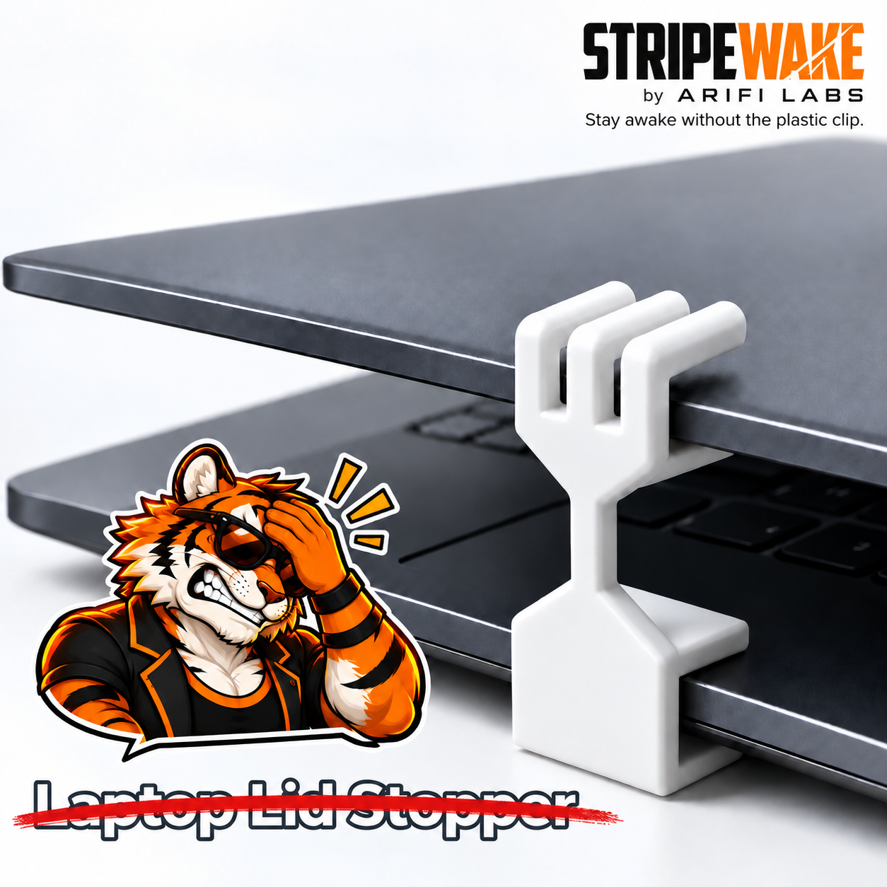
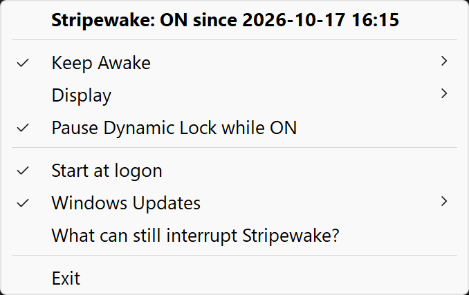
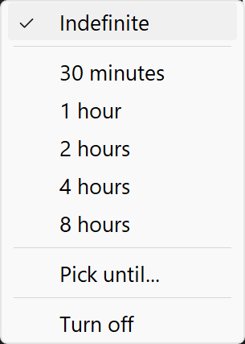
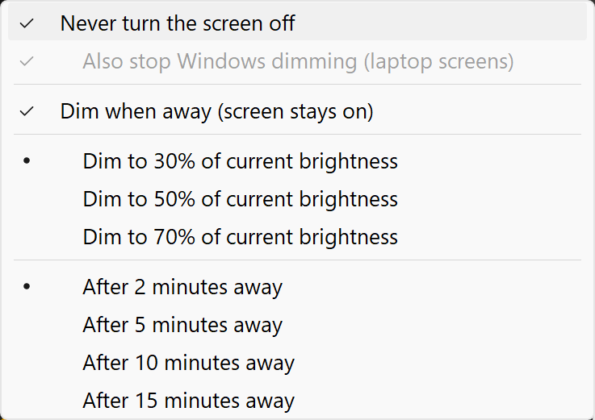
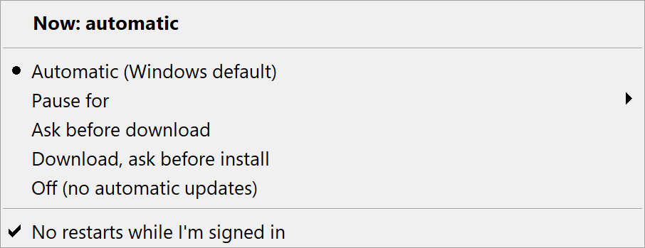
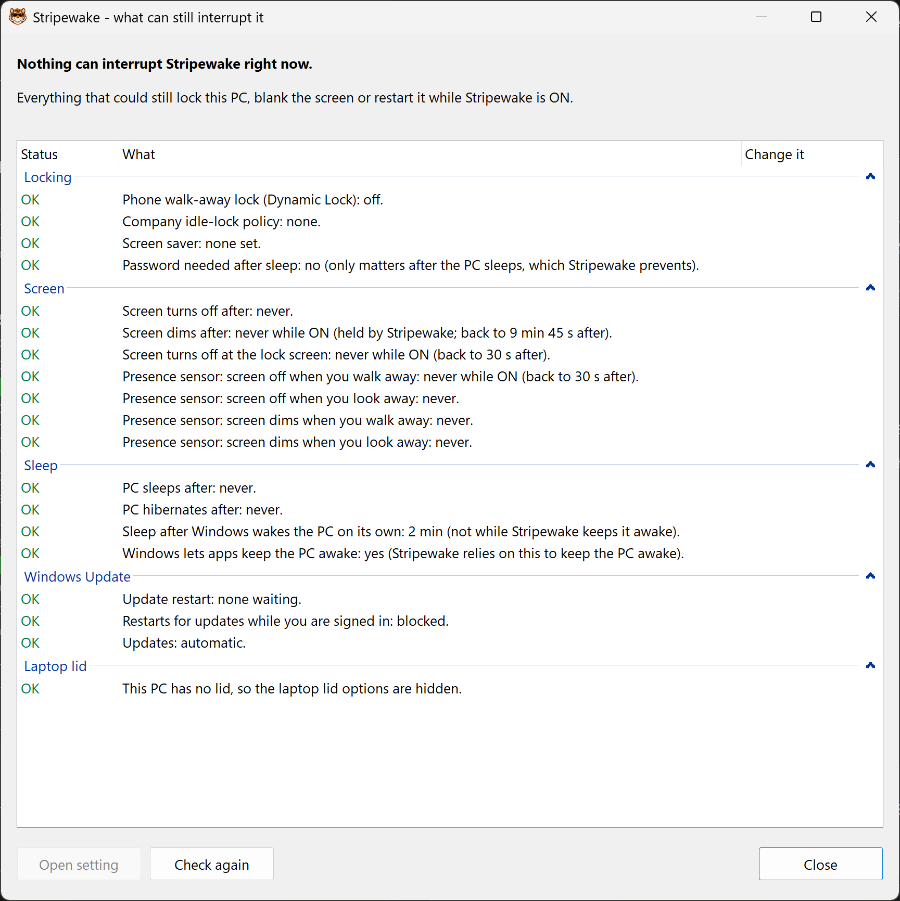

<h1 align="center">Stripewake</h1>

<p align="center"></p>

<p align="center"><b>Keep your Windows PC awake from the tray. One click. No lock, no dark screen, no plastic clip.</b></p>

<p align="center">499 KB · 1.8 MB private memory · 0 ms of CPU at idle · PolyForm Shield · Windows 11</p>

## Why Stripewake

<p align="center"></p>

Stripewake keeps your PC awake, your screen on and surprise restarts on hold, from one tray icon. It is for the
jobs that must not stop: local AI and model runs, builds, renders, long scripts, big downloads, presentations.
No sleep halfway through. No surprise windows update restart at 3 a.m. No lock screen in the middle of a demo.

It weighs almost nothing. One 499 KB program in plain C, 1.8 MB of private memory, 0 ms of CPU while idle.
The usual alternative, PowerToys, runs 4 processes and 140 MB of private memory (measured).

It also tells you what can still lock, blank or restart your PC, and opens the exact Windows setting to fix it.
Turn it off and every setting it touched goes back exactly as it was.

### From the tray, in one or two clicks

| You want to | Stripewake does |
|---|---|
| Keep the PC awake | One click. Indefinitely, for 30 min to 8 h, or until a date and time you pick. |
| Keep the screen on | Holds it on while ON. Optionally stops Windows dimming it too. |
| Save power while you're away | **Dim when away:** after 2 to 15 minutes without input, every screen drops to 30, 50 or 70%, external monitors included. Touch the mouse and it's back. It takes over from Windows' own dim, so there is only one. |
| Stop update restarts | Pause updates for 1 day to 5 weeks, ask before download or install, or no restarts while you're signed in. |
| Close the laptop lid | Keep running with the lid closed, plugged in or always. |
| Stay unlocked when your phone wanders off | Pauses Dynamic Lock while ON. |
| Know what can still interrupt you | One window lists every trap, worst first, with a button to the exact setting. |

## Stripewake vs PowerToys

Measured on one PC on 2026-10-16, both running at the same time over the same 10-minute idle window.

| Measure | Stripewake | PowerToys Awake process only | PowerToys (all processes) |
|---|---|---|---|
| Processes | **1** | 1 | 4 (PowerToys, Awake, AlwaysOnTop, QuickAccess) |
| Working set RAM | **11.0 MB** | 36.4 MB | 104.5 MB |
| Private memory | **1.8 MB** | 14.9 MB | 140.7 MB |
| CPU time over 10 min idle | **0 ms** (below the 15.6 ms clock tick) | 62.5 ms | 1,234 ms |
| Install folder on disk | **0.47 MB** (2 program files) | n/a (one shared install) | 1,033.3 MB (3,002 files) |

<details>
<summary>How it was measured</summary>

Windows 11 Pro Insider Preview 10.0.29683.1000, 16:26 to 16:36 EDT. PowerToys 0.101.2362.0 (per-user install,
modules as the owner runs them); Stripewake 1.0.0 ON with the display kept on and default settings. CPU time is the change over the
window; working set and private memory are the readings at its end. MB = 1,000,000 bytes. The Stripewake disk row
counts the program files (`Stripewake.exe` and `LICENSE.txt`); the Inno Setup uninstaller adds 4.74 MB. The current build is 499,200 B (0.51 MB with LICENSE.txt). A
recheck of the current build on 2026-10-16 21:0x read 10.8 MB working set and 1.7 MB private memory.
</details>

## Features

- **One click.** Left-click the tray icon to toggle ON and OFF. It starts ON at sign-in and stays ON.
- **Timers.** Indefinite (the default), 30 min, 1 h, 2 h, 4 h, 8 h, or until a date and time you pick. Hover for a
  live countdown: `Stripewake: ON - 1 h 23 m left (until 17:30)`. When a timer ends it turns OFF quietly.
- **Display menu.** Three choices for the screen:
  - **Never turn the screen off** (on by default). The screen stays on while ON, but Windows may still dim it to
    save power.
  - **Also stop Windows dimming** (laptop screens). Holds Windows' dim timer too, so the screen stays at full
    brightness.
  - **Dim when away** (off by default). The screen stays on, but after 2, 5, 10 or 15 minutes without mouse or
    keyboard input (default 5), every screen drops to 30, 50 or 70% of its current brightness (default 50%):
    external monitors over DDC/CI, a laptop's built-in screen through Windows' panel brightness control. The first
    touch of the mouse or keyboard puts it back. A full-screen video, game or presentation does not count as away.
    While Dim when away is on, Windows' own dim timer is held, so Stripewake is the only dim; **Also stop Windows
    dimming** shows ticked and grey.
- **Lit lock screen.** Win+L hides your screen but does not turn it off.
- **Screen saver paused** while ON, and back when OFF. Your saved setting is never rewritten.
- **Presence sensors** (PCs with one): walking away or looking away does not blank the screen while ON.
- **Dynamic Lock paused** while ON (phone-proximity lock). Untick **Pause Dynamic Lock while ON** to keep it.
- **Laptops: lid closed.** Keep running when plugged in, or always. Below 10% battery the lid goes back to Windows.
- **What can still interrupt Stripewake?** One window lists everything that can still lock, blank or restart the
  PC, worst first: Action needed (red), Info (amber), OK (green). **Open setting** opens that exact Windows setting,
  **Turn on** switches on the Stripewake option that fixes it, and **Check again** re-reads everything. It covers Dynamic Lock, company idle-lock and screen-saver policies, your
  screen saver, Windows Update restarts, every power-plan timeout, presence sensors and the lid. It changes nothing
  until you click a button.
- **Windows Updates, your call** (off by default). One menu: Automatic, Pause for 1 day to 5 weeks, Ask before
  download, Download and ask before install, or Off. Plus **No restarts while I'm signed in**. The top line shows
  the live state, e.g. `Now: paused - 6 d 23 h left (until 2026-10-23 18:36)`.
- **Restart notice.** When Windows has a restart pending, the tooltip says since when.
- **Nothing left behind.** Every setting it changes is saved first and put back when it turns OFF, after a forced
  stop (at the next start), and on uninstall.
- **Silent.** No pop-ups, no balloons. Every change writes one dated line to `%LOCALAPPDATA%\Stripewake\state.log`.

## How it works

- **Awake:** while ON, Stripewake calls `SetThreadExecutionState(ES_CONTINUOUS | ES_SYSTEM_REQUIRED)`, so Windows
  does not sleep or hibernate. `powercfg /requests` lists `Stripewake.exe` under SYSTEM.
- **Screen on, dimming allowed:** instead of a display request (which also blocks dimming), it holds your power
  plan's "turn off display after" at never. If that plan setting cannot be written, it falls back to
  `ES_DISPLAY_REQUIRED`.
- **Power-plan holds** (display off, lock-screen display, presence timeouts, lid action) follow one rule: save the
  current value to `%LOCALAPPDATA%\Stripewake\restore.ini` first, write the new value, and put the old value back
  when ON ends. A forced stop is repaired at the next start, and the uninstaller runs the same restore.
- **Idle by default.** With the default settings it waits for Windows messages and sets one timer for a timer's end
  time. Nothing ticks in the background, which is why idle CPU is 0 ms. Turn on **Dim when away** and it checks the
  time of your last input every 2 seconds (every 250 ms while the screen is dimmed, so it comes back at once). While
  the menu is open with a countdown, the countdown repaints once a second.
- **Dim when away:** external monitors get their brightness over DDC/CI (the monitor's own control channel); a
  laptop's built-in screen uses Windows' panel brightness control. Stripewake reads the current brightness first and
  puts exactly that back.
- **Windows Update** choices change only Windows' own settings (the ones Settings and Group Policy use). Each
  change asks for admin rights through the normal Windows prompt; say No and nothing changes. The first time, a
  warning asks you to confirm that updates, security fixes included, wait until you set it back to Automatic.

## Screenshots

| Tray menu | Keep Awake | Display |
|---|---|---|
|  |  |  |

| Windows Updates | What can still interrupt |
|---|---|
|  |  |

Captured on Windows 11 at 225% display scaling.

Tray icons at 32 px (ON, timer, OFF) on a dark and a light taskbar:


## Install

Download `Stripewake-<version>-setup.exe` from the Releases page. The first page asks:

- **Just me** (no admin): installs to `%LOCALAPPDATA%\Programs\Stripewake` and starts at your sign-in.
- **All users** (admin): installs to `Program Files` and starts at every user's sign-in.

Uninstall from Settings > Apps; it puts back every setting it changed. Portable use: run `Stripewake.exe` from
any folder; it adds itself to startup only if you tick **Start at logon**.

| Action | Result |
|---|---|
| Left-click the icon | Toggle ON / OFF |
| Hover the icon | Status and countdown |
| Right-click the icon | Menu |

Icons: bright = ON, bright with a clock = timer running, grey = OFF.

## Limits

- **Your own Sleep, Shut down and Restart always win.** Stripewake never blocks them.
- **Critical battery:** Windows hibernates no matter what.
- **Company policies win.** An idle-lock or screen-saver policy set by your organization is reported as Action
  needed, not overridden. Ask your IT admin to exempt the device.
- **Windows Update pause length** is capped by Windows on each PC (Insider builds allow 7 days).
- **Dim when away** is tested on an external monitor over DDC/CI. Laptop screen dimming is not yet tested on a real
  laptop. Some monitors do not answer DDC/CI, or have it switched off in their own menu; those are left alone.
- **Windows only.** Built and tested on Windows 11.
- **Not code-signed yet,** so Windows SmartScreen shows a warning the first time you run the installer.

## Test status

| Feature | Tested | How |
|---|---|---|
| Keep awake | TESTED | `powercfg /requests` lists it under SYSTEM while ON, absent when OFF. |
| Never turn the screen off, dimming allowed | TESTED | "Turn off display after" held at never while ON and put back; no DISPLAY request, so dimming still works. |
| Timers + countdown | TESTED | `/for 120` went OFF to the second; menu captures 2 s apart show the countdown move; "Pick until..." date and time picker tested by hand on 2026-10-17. |
| Crash-safe restore | TESTED | Forced kills, then restart or `/restore`, read back equal to the originals. |
| Dim when away (external monitor) | TESTED | Dimmed to the picked level after the picked time over DDC/CI; brightness back on the first input. |
| Dim when away (laptop screen) | Untested (needs a laptop) | Code path only. |
| Lit lock screen | Setting TESTED; real lock screen untested | `powercfg /qh ... VIDEOCONLOCK`: 30 s, never while ON, 30 s after. |
| Dynamic Lock pause | Save/restore TESTED; real phone untested | Read-backs: absent, 1, forced stop, timer end, uninstall. |
| Lid closed (laptops) | Save/restore TESTED; real lid untested | Forced lid path on a PC without a lid; `LIDACTION` read-backs. |
| Battery cut-off | Untested (needs a laptop) | Code path only. |
| Screen saver pause | Untested with a real screen saver | The test PC has none set; with none set Stripewake changes nothing. |
| What can still interrupt | TESTED | Opened with `/check` and captured above. |
| Windows Updates choices | Elevated write TESTED; menu click + admin prompt untested | `/wu set` for each state read back; bad arguments refused (exit 87); settings put back. |
| No restarts while signed in | Elevated write TESTED; menu click + admin prompt untested | `/wu noreboot 0`, `absent`, `1` each read back. |
| Installer | Just me TESTED; All users untested | Per-user install on the test PC. |
| Start at sign-in | TESTED | Installed on the test PC; the sign-in entry is present. |

## Build

To **run** Stripewake you need nothing extra: the program uses only DLLs that ship with Windows (kernel32, user32,
gdi32, shell32, advapi32, comctl32, powrprof). No .NET, no Visual C++ runtime.

To **build** it:

| Tool | Needed for | Install |
|---|---|---|
| Visual Studio 2022 Build Tools, "Desktop development with C++" (MSVC x64 + Windows SDK) | `Stripewake.exe` | `winget install Microsoft.VisualStudio.2022.BuildTools --override "--quiet --add Microsoft.VisualStudio.Workload.VCTools --includeRecommended"` |
| Inno Setup 6 | the installer (skipped if absent) | `winget install JRSoftware.InnoSetup` |
| Python 3 + Pillow | only to redraw icons and installer images in `art/` | Python from python.org, then the Pillow package from PyPI |

`build.cmd` finds MSVC through vswhere, so it runs from any prompt.

```bat
build.cmd
```

Output: `build\Stripewake.exe` and `build\Stripewake-1.0.0-setup.exe`. Switches: `Stripewake.exe /check` shows the
status window and exits; `Stripewake.exe /for 120` starts with a 120-second timer (for testing).

Icons: `python art/make_icons.py` rebuilds the ON and OFF tray icons (16 to 48 px for every display scaling, plus
256 px) from the head images in `art/`; `python art/make_icons.py --timer <image>` rebuilds only the timer icon.

## License

PolyForm Shield License 1.0.0. See [LICENSE](LICENSE). Made by Arifi Labs.

In plain English: Stripewake is free to use, at home and at work. You may not sell Stripewake, or use its code in a product that competes with it.

The Stripewake name, icon and tiger artwork belong to Arifi Labs and are not licensed under the PolyForm Shield License. Forks and copies may not use them.

Not affiliated with or endorsed by Microsoft; PowerToys is a Microsoft project.
